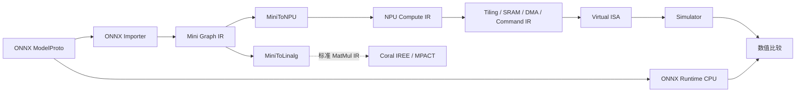

# Day 18 · MiniNPUCompiler 方案 C

本项目采用 ONNX → MLIR → Virtual NPU，复用 MiniMLIRCompiler 的 Dialect、PassManager、CMake、`mini-opt` 和 CTest。Day 18 冻结前端、IR、Lowering 与执行验证之间的契约，并用真实 ONNX fixture 验证模型及参考数据协议。

Importer 保留模型语义、函数签名和 SSA。Graph IR 可以使用现有 Mini Verifier 与图优化。MiniToNPU 为目标设备选择计算表示。后端根据 [Virtual NPU v1 配置](../../configs/virtual-npu-v1.json) 产生 Tile、SRAM 分配、DMA 和指令。运行时绑定输入及权重，在 Simulator 中执行，输出端按 ONNX Graph 的名称和顺序导出 Tensor。[IR 分层](ir-levels.md)、[验证协议](validation-contract.md)

## 现有实现与后续交付

| 状态 | 内容和入口 |
| --- | --- |
| Implemented | [Mini ODS](../../include/Mini/MiniOps.td) 和 [Verifier](../../lib/Dialect/Mini/MiniOps.cpp) 已定义 Add、Mul、ReLU、AddReLU。另有用于工程验证的 Ping。 |
| Implemented | [MiniToLinalg](../../lib/Conversion/MiniToLinalg.cpp) 使用 Full Conversion 降低四种计算算子。[mini-opt](../../tools/mini-opt/mini-opt.cpp) 注册 `mini-compile`。[CTest](../../test/CMakeLists.txt) 覆盖解析、Verifier、融合与转换。 |
| Implemented | [Day 18 ONNX fixture 生成器](../../python/e2e/generate_models.py) 生成真实加权 MatMul→ReLU 模型、输入与元数据。已经运行 ONNX Runtime CPU，保存独立参考输出。 |
| Designed | [ONNX Importer](onnx-import-contract.md)、[三层 IR](ir-levels.md)、[Lowering](lowering-contract.md) 和 [两条 Pass Pipeline](pass-pipeline.md) 接口。 |
| Planned | Day 19 的 `mini.matmul` 与最小导入，Day 20 的 `npu.matmul`、Initializer、多节点导入与通用数值比较工具，Day 21 的 `MiniToNPU` 与集成。Command IR、Virtual ISA、Simulator 在第四周。 |
| Unsupported | 第一版动态 Shape、Batch MatMul、广播、控制流、自定义域与 External Data。NPU Compute 首版只接收 MatMul 计算。 |
| Experimental | Coral 独立 MPACT G1 已通过。G2、G3 待验证。[Day 17 环境报告](coral/environment-report.md) |

Day 15 的 TVM 子图 Adapter 保留为前端扩展设计。方案 C 用可保存、可重放的 ONNX 图定义项目输入，并用 ONNX Runtime 建立独立参考。未来 TVM Adapter 应复用 Mini Graph IR 的接口。Coral 选择标准 Linalg 作为接入点，预期由 Coral IREE 负责真实设备的优化和代码生成，并由其 Runtime 与 MPACT 执行。自研 Virtual ISA 和对应硬件配置属于另一目标。[TVM 接口研究](tvm-adapter-contract.md)、[Coral 工具链](coral/toolchain-research.md)

## 验收路径

1. Day 19 的第一个正例使用两个外部 FP32 输入的 ONNX MatMul，验证参数、Shape 和结果 SSA。当前加权 MatMul→ReLU fixture 用于较完整的前端路径。
2. Day 20 导入当前 fixture，函数只有 `X` 一个参数，`W` 进入常量，ReLU 使用 MatMul 结果。用后续单独的加权 MatMul fixture 验证 NPU 正例。
3. Day 21 加权 MatMul 通过完整转换，保留常量并产生 `npu.matmul`。当前 MatMul→ReLU fixture 通过导入后，其存活的 ReLU 触发目标合法化失败。
4. Week 4 将已合法化的 MatMul 拆分并执行，同一输入的实际结果与黄金输出比较。G2/G3 不参与自研主线验收。
