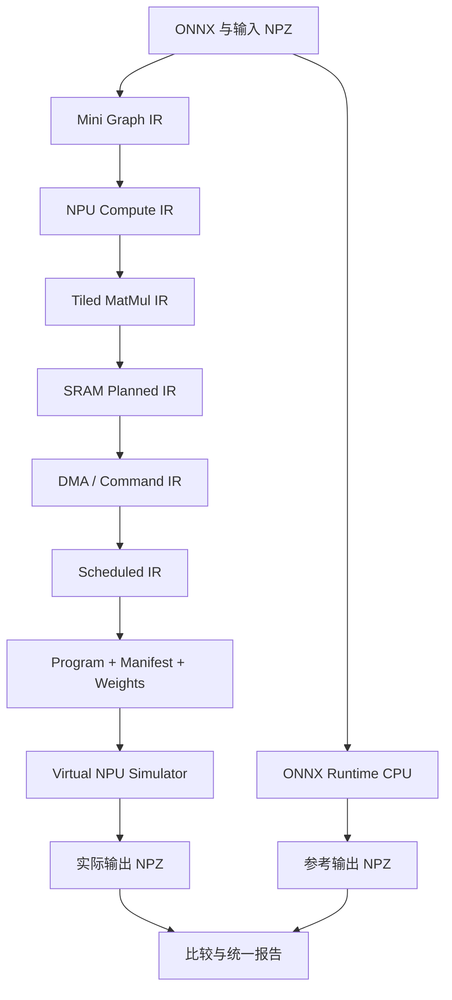

# MiniNPUCompiler · 后端架构

MiniNPUCompiler 在编译期逐层固定一次 MatMul 的实现方式。执行器消费的是
这些决策形成的程序包。Day 28 的 E2E Driver 把工具连起来，保留每一层
的输入、输出和诊断。

| 层与产物 | 主要入口 | 不变量与失败归属 |
| --- | --- | --- |
| ONNX → `01-imported.mlir`，`mini.matmul` | [Importer](../../python/onnx_importer/importer.py) | 名称按 ONNX 接口绑定，Initializer 成为 Dense FP32 常量。非法图、形状或 K 维冲突在导入时拒绝。 |
| `02-npu-compute.mlir`，`npu.matmul` | [MiniToNPU](../../lib/Conversion/MiniToNPU.cpp) | 支持的计算完整合法化到 NPU 方言，函数签名和 SSA 关系保留。存活的 `mini.relu` 使转换失败。 |
| `03-tiled.mlir`，`npu.tiled_matmul` | [NPUTiling](../../lib/Backend/NPUTiling.cpp) · [TilePlan](../../lib/Dialect/NPU/TilePlan.cpp) | 按 M/N/K 组织 Tile，范围完整覆盖且尾块有效尺寸不超过原生上限。 |
| `04-sram-planned.mlir`，`npu.sram_planned_matmul` | [SRAMPlanner](../../lib/Backend/SRAMPlanner.cpp) · [MemoryPlan](../../lib/Dialect/NPU/MemoryPlan.cpp) | 绑定 A/B/C，检查半开生存期、对齐、容量和同一时刻的冲突。内存不足在产生 DMA 前报告。 |
| `05-command.mlir`，`npu.command_matmul` 与 `npu.dram_layout` | [DMAInsertion](../../lib/Backend/DMAInsertion.cpp) · [CommandPlan](../../lib/Dialect/NPU/CommandPlan.cpp) | 为完整 Tensor 绑定 DRAM；为每个 Tile 发出 ZERO、LOAD、MATMUL、STORE 并校验二维窗口。 |
| `06-scheduled.mlir`，新增 `npu.execution_schedule` | [NPUScheduler](../../lib/Backend/NPUScheduler.cpp) · [ScheduleState](../../lib/Dialect/NPU/ScheduleState.cpp) | 区分全局序号和局部事件，验证 K 归约、存储冲突及跨 MatMul 的完整写回。 |
| Virtual ISA 三文件 | [CodeGen](../../tools/mini-npu-codegen/mini-npu-codegen.cpp) · [VirtualISA](../../lib/CodeGen/VirtualISA.cpp) | 从已验证的顺序逐字段编码，按位打包 FP32 权重，保留 I/O ABI。发布前复验完整性。 |
| 实际输出 NPZ 与 Trace | [Simulator](../../runtime/virtual_npu/interpreter.py) | 读真实 SRAM/DRAM 字节，按固定顺序累加。未加载的 Buffer、提前 STORE 和不完整写回属于运行时错误。 |
| 参考 NPZ 与统一报告 | [E2E Driver](../../python/e2e/run_e2e.py) · [Comparator](../../python/e2e/compare_outputs.py) | 两条路径使用同一份 ONNX 与固定 NPZ。比较原模型参考结果和 Virtual NPU 执行结果，记录失败阶段和原始证据。 |

## 三层身份

以 `H = X @ W1`、`Y = H @ W2` 为例：

- **SSA 值**表示图上的 H 从哪条操作产生、被谁消费；等式还没有物理地址。
- **DRAM Tensor ID**标识整个 H 的持久存储。Day 28 的 Chain 用例中，
  Tensor `3` 在 DRAM `256`，Seq `4` 的 STORE 写 H，Seq `6` 的 LOAD
  读 H。它同时是前一组的结果 ID 与后一组的第一个 Operand ID。
- **SRAM Buffer ID**只标识某个 MatMul 组中的局部 Tile 及生命周期。
  前一组的 C 经过 STORE 释放后，后一组可以在同一物理地址创建新的
  Buffer。完整 H 在 DRAM 中跨组存活。

这三层身份将编译器的逻辑数据流、全局 DRAM 布局与片上短期复用关联起来。
多输出模型进一步验证接口顺序由 ONNX Graph Output 决定，`Y, H`
可以映射到 DRAM Tensor `4, 3`。

## 资源与执行证据

CodeGen 从解码后的 `MemoryPlan` 导出每组计划的活跃峰值与地址高水位。
当前 MatMul 组串行执行，因此全局峰值取各组的最大值。Program 记录将要
执行的指令和 DMA 字节。Trace 记录已完成的指令和实际完成的搬运。最后
由 Comparator 判断输出数值是否满足原有容差。详见 [复现与报告接口](e2e-validation.md)。
