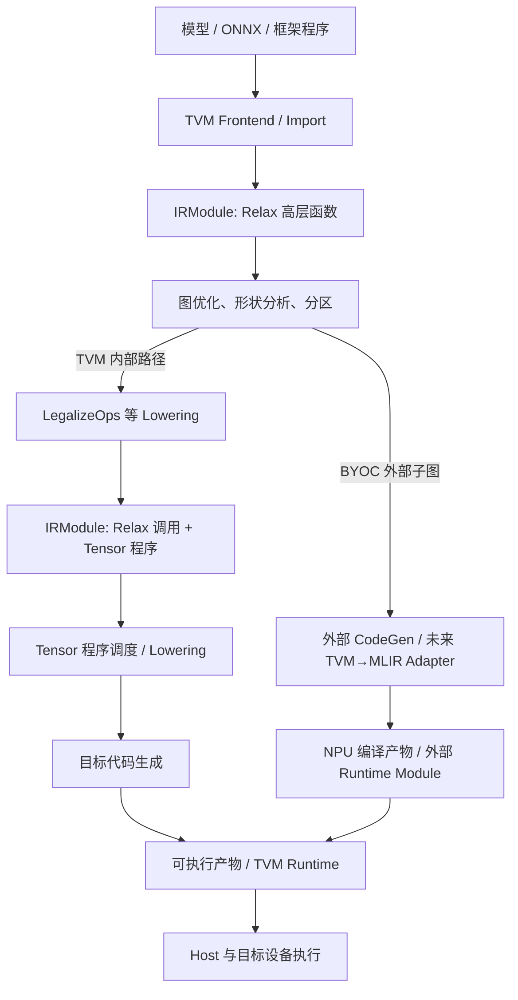

# TVM 编译器架构与 NPU 接入边界（Day 15）

> 本文是架构分析，不是已运行的 TVM 示例。依据 2026-11-13 阅读的 Apache TVM 官方文档；实现前须以团队使用的 TVM 版本重新核对 API 与源码位置。

## 1. 从模型到执行



这张图表达两条**可能的编译路径**，不是每个算子都必须走完所有方框。模型语义主要在 Frontend、Relax 和图 Pass 中；目标设备信息在分区、调度、CodeGen 中逐步介入。Runtime 负责加载产物、安排调用、传递数据和与设备交互，不能由“生成了 NPU 指令”自动替代。TVM 的 [总体架构](https://tvm.apache.org/docs/arch/)和 [BYOC 说明](https://tvm.apache.org/docs/arch/external_library_dispatch.html)描述了这些职责。

### 各层究竟保存什么

| 层 | 关键问题 | 典型内容 | 在本项目中的近似对应 |
| --- | --- | --- | --- |
| Relax；历史项目可能是 Relay | 要计算什么，值之间怎样依赖？ | 函数、调用、Tensor 结构信息、符号 Shape、数据流 | `Mini` Operation 与 `func.func` |
| IRModule | 哪些函数属于同一个编译单元，如何互相调用？ | 高层函数、较低层 Tensor 函数及全局引用 | MLIR `module`，但内部对象体系并不等价 |
| TensorIR / Tensor 程序 | 每个输出元素怎样由输入算出？ | 迭代、Buffer 读写、归约、调度 | `linalg.generic` 的迭代域和索引映射，仅是职责类比 |
| Pass | 怎样按阶段改变 IR？ | 分析、合法化、融合、分区、调度 | Mini 的融合 Pass、Conversion Pass 与 Pipeline |
| Target / CodeGen | 针对什么硬件，生成何种产物？ | 设备能力、指令选择、内核编译 | 将来的 MiniNPU 后端，目前尚无 |
| Runtime | 产物如何被加载和执行？ | 函数调用、设备交互、数据传递 | 将来的运行时 / Simulator，目前尚无 |

当前 [TVM 架构文档](https://tvm.apache.org/docs/arch/)使用 `relax::Function` 和 `tirx::Function` 描述共存于 IRModule 的函数。TensorIR 仍是理解算子级计算的概念；旧教程中的 `tir.PrimFunc`、`tvm.build` 和 Relay 属于不同年代的具体接口。文档导航还分别列出 TIRx 与调度相关内容。本文只做**职责映射**，不拼接不同版本的可执行 API。

## 2. 用 `Y = ReLU(XW + b)` 走一遍

令 `X: f32[2,3]`、`W: f32[3,4]`、`b: f32[4]`，则 `XW: f32[2,4]`，Bias 沿第 0 维广播，`Y: f32[2,4]`。

高层图保留三个依赖：

```text
%mm  = MatMul(%x, %w)       // [2,4]
%sum = Add(%mm, %b)        // [2,4] + [4]，有广播语义
%y   = ReLU(%sum)          // [2,4]
```

下沉到算子级时，MatMul 的核心关系才变得显式：

```text
for i in [0, 2):          // M：输出行，空间轴
  for j in [0, 4):        // N：输出列，空间轴
    acc = 0
    for k in [0, 3):      // K：归约轴
      acc += X[i,k] * W[k,j]
    Y[i,j] = relu(acc + b[j])
```

这是数学伪代码，未规定真实 Kernel 的循环顺序、数值舍入或内存布局。`M,N` 的不同输出位置通常可独立计算；同一 `(i,j)` 的各个 `K` 贡献必须归约。若 `M=N=K=128`，按 `32×32` 切分输出会得到 `4×4=16` 个输出 Tile；若 K 也按 32 切分，每个输出 Tile 还要累积 4 个 K Tile。**输出 Tile 数不等于乘加 Tile 数。** [TensorIR 的计算抽象](https://tvm.apache.org/docs/deep_dive/tensor_ir/abstraction.html)将这类迭代和 Buffer 访问显式表示，调度再决定切分、重排和映射。

图层的三个算子不保证对应三个 Kernel：[TVM 的融合文档](https://tvm.apache.org/docs/arch/fusion.html)区分了 `FuseOps` 的图分组与 `FuseTIR` 的低层函数合并。若 MatMul 的结果还有其他使用者，融合必须保留那个使用者所需的值；不能仅因为图上相邻就删掉中间结果。Mini 的 [AddReluFusion.cpp](../../lib/Transforms/AddReluFusion.cpp) 用 `hasOneUse()` 避免这种简单模式下的错误删除。

### 三个“融合”不是一回事

| 决策层 | 主要改变 | 还不能据此断言 |
| --- | --- | --- |
| 图融合 | 把一组图节点视为一个复合计算 / 后端候选 | 已产生单个机器 Kernel |
| Kernel 融合 | 将低层计算组织为更少的内核和中间物化 | 已映射到 NPU 特定执行单元 |
| 硬件融合 | 利用 NPU 的累加、激活或后处理能力 | 所有 Shape / DType 都支持该融合 |

Mini 的 `mini.add_relu` 是**图上的融合语义**；当前 [MiniToLinalg.cpp](../../lib/Conversion/MiniToLinalg.cpp) 将其生成一个 `linalg.generic`，仍是标准 MLIR 计算表示，不是 NPU 指令，也没有完成 Bufferization 或物理内存复用。

## 3. IRModule 为什么容纳不同层次

概念上，一个模块可以同时有高层 `forward` 和低层 `matmul_kernel`：

```text
IRModule
├── forward: Relax Function
│   └── 调用 matmul_kernel，处理其他图节点
└── matmul_kernel: Tensor 程序函数
    └── 迭代、归约与 Buffer 访问
```

Lowering 可以先增加低层函数，再把高层调用改指向它；无须一次把所有函数变成同一层。收益是保留调用关系、逐步转换、跨层跟踪 Shape 和签名；代价是每个 Pass 必须知道处理哪些函数，以及调用约定是否仍有效。[官方架构说明](https://tvm.apache.org/docs/arch/)以 `LegalizeOps` 为例展示这种高低层共存。

Mini 在一个 MLIR Module 中暂时容纳 `mini.*` 与标准 Dialect Operation，体现类似的渐进 Lowering 思想；但 TVM 的不同函数 IR 与 MLIR 的 Dialect/Operation/Region 机制没有一一对应关系。Mini 的 [Full Conversion](../../lib/Conversion/MiniToLinalg.cpp) 最终要求计算算子不再是 `mini.*`，这只是本阶段的转换目标。

## 4. Pass、Target、Runtime 与外部后端

TVM 的 `Sequential` 明确排列 Pass，`PassContext` 管理上下文配置、优化级别等；Mini 的 `mini-compile` 也显式排列融合、转换和清理。顺序具有语义影响：先图融合再 Lowering，才能匹配 `mini.add → mini.relu`；变成 `linalg.generic` 后，原图 Pattern 已失效。两套 Pass 框架的对象模型和接口不同，不能直接移植 Pass 实现。[TVM Pass 基础设施](https://tvm.apache.org/docs/arch/pass_infra.html)、[MLIR Pass 管理](https://mlir.llvm.org/docs/PassManagement/)。

Target 描述编译时所需的硬件能力与代码生成选择；Runtime 管执行时的调用、模块加载和设备通信。真实 NPU 还需确定 Shape / DType 支持、SRAM 与 DMA 限制、Host/NPU 传输、张量所有权和同步。编译器可以成功产出 NPU 程序，运行时仍可能因 ABI 或数据传输约定不匹配而失败。[TVM 设备与 Target 文档](https://tvm.apache.org/docs/arch/device_target_interactions.html)。

BYOC 的候选流程是：识别可交给外部后端的 Relax 子图（例如 `FuseOpsByPattern`）→ 标注复合函数和 Codegen → `RunCodegen` 调外部代码生成 → 外部模块和其余 TVM 产物共同进入 Runtime。它提供**分区与外部代码生成的挂接点**，不自动提供语义等价的 Adapter、设备间拷贝策略或 NPU 运行时 ABI。[BYOC 官方说明](https://tvm.apache.org/docs/arch/external_library_dispatch.html)。

## 5. 对 MiniNPUCompiler 的具体决策

本项目目前的链路是 `Mini Graph → AddReluFusion → Tensor/Linalg/Arith`，见 [README](../../README.md)。它完成了图表示、局部图优化和通用计算 Lowering；尚无 MatMul、NPU 计算 IR、Tiling、Memory Planning、目标代码或 Runtime。因此 Day 15 位于**前端/后端接口与目标后端架构设计阶段**，不是设备指令生成阶段。

若真实团队已有 TVM 前端，适合先评估“TVM 做图优化并划分 NPU 子图，MLIR 接收该子图”这条渐进路线。它降低首版导入覆盖面，但边界上的广播、常量、Layout、调用签名及 Runtime 仍必须写成契约。具体输入输出和失败策略见 [Adapter 契约](tvm-adapter-contract.md)。若团队需要全图跨层优化或保留已有深度 TVM Kernel 优化，最终边界可能不同。

## 6. 官方阅读与源码定位

| 资料 | 读它是为了回答 |
| --- | --- |
| [总体架构](https://tvm.apache.org/docs/arch/) | IRModule、编译阶段和 Runtime 如何衔接？ |
| [Relax](https://tvm.apache.org/docs/deep_dive/relax/index.html)、[TensorIR](https://tvm.apache.org/docs/deep_dive/tensor_ir/index.html) | 图语义和元素计算各保存什么？ |
| [Pass 基础设施](https://tvm.apache.org/docs/arch/pass_infra.html) | Pass 如何组织与配置？ |
| [融合](https://tvm.apache.org/docs/arch/fusion.html)、[BYOC](https://tvm.apache.org/docs/arch/external_library_dispatch.html) | 图融合、Kernel 融合、外部子图编译的边界？ |
| [fuse_ops.cc](https://github.com/apache/tvm/blob/main/src/relax/transform/fuse_ops.cc) | 图分组的实现入口；对应 Mini 的图融合职责 |
| [fuse_tir.cc](https://github.com/apache/tvm/blob/main/src/relax/transform/fuse_tir.cc) | 低层函数融合的实现入口；Mini 目前尚无对应 Pass |
| [run_codegen.cc](https://github.com/apache/tvm/blob/main/src/relax/transform/run_codegen.cc) | 外部 CodeGen 的接入入口；未来 Adapter 的上游边界 |

源码路径随 TVM 版本变化，表格只是当前阅读定位，不是稳定 API 承诺。
